# 🛍️ Just a Shop

**Just a Shop** is a Flutter-based e-commerce mobile application designed to provide a simple and user-friendly shopping experience. It features modern UI design, product browsing, API integration, authentication, localization, state management, and maintainable code.

## ✨ Features

### 🎨 UI & User Experience
- Native splash screen.
- Three onboarding screens with page indicators.
- Responsive UI using Flutter ScreenUtil.
- Light and dark theme support.
- Arabic and English language support.
- Persistent theme and language preferences using Hive.
- Home screen with a promotional banner.
- Home header with search and sorting options.
- Product and category browsing.
- Bottom navigation bar.

### 🔐 Authentication
- User registration and login using a REST API.
- Google Sign-In using Firebase Authentication.
- Facebook Login using Firebase Authentication.
- Authentication error handling.
- Loading states during authentication.
- Secure session management and persistent login.

### 🛒 Products & Categories
- Fetch and display products from the DummyJSON API.
- Browse product categories.
- View products by category.
- Search for products.
- Sort products by price, from low to high or high to low.
- Pagination to load more products while scrolling.
- Loading indicators and error handling.
- Retry failed API requests.

### 💾 Data Storage
- **Hive & Hive Flutter:** Store user preferences, including theme and language settings.
- **Flutter Secure Storage:** Securely store access and refresh tokens.
- **SharedPreferences:** Store selected data returned by the API.
## 🛠️ Technologies & Packages

| Technology / Package | Purpose |
|---|---|
| Flutter & Dart | Cross-platform mobile development |
| flutter_bloc / Cubit | State management |
| Dio | API requests and network communication |
| Pretty Dio Logger | Logging network requests during development |
| Firebase Core | Firebase initialization |
| Firebase Authentication | Authentication integration |
| Google Sign-In | Google authentication |
| Flutter Facebook Auth | Facebook authentication |
| Hive | Local storage for app preferences |
| Hive Flutter | Hive integration with Flutter |
| SharedPreferences | Simple key-value storage |
| Flutter Secure Storage | Secure token storage |
| Easy Localization | Arabic and English localization |
| Flutter ScreenUtil | Responsive UI adaptation |
| Flutter Native Splash | Native splash screen configuration |
| Flutter SVG | Rendering SVG assets |
| Build Runner | Generating Hive Type Adapters|
| Paymob | Payment gateway integration |
| flutter_inappwebview | Displaying the payment gateway inside the app |
| Git & GitHub | Version control and team collaboration |

## 🌐 API Integration

The application uses the DummyJSON REST API with Dio for product management and simulated authentication.

### Products API
- Fetch and display products.
- View product details.
- Browse categories and filter products by category.
- Search for products.
- Sort products by price (low to high and high to low).
- Pagination for loading more products.
- Error handling and retry functionality.

### Authentication API
- User login using email and password.
- Simulated user registration using the Add User endpoint.
- Access and refresh token handling.

## 🚀 Installation & Setup

### Prerequisites

Make sure you have the following installed:

- Flutter SDK
- Dart SDK (included with Flutter)
- Android Studio or VS Code
- Android SDK
- Git

### 1. Clone the Repository

```bash
git clone https://github.com/rahmaEbrahem/just_a_shop.git
```

### 2. Navigate to the Project Directory

```bash
cd just_a_shop
```

### 3. Install Dependencies

```bash
flutter pub get
```

### 4. Generate Required Files

Run the following command to generate required files for packages that use code generation:

```bash
dart run build_runner build --delete-conflicting-outputs
```

### 5. Generate Localization Keys

Generate the localization key file from the translation assets:

```bash
dart run easy_localization:generate --source-dir ./assets/translation -f keys -o locale_keys.g.dart -O lib/gen
```

Make sure the translation files exist in the configured source directory.

### 6. Configure Firebase

Configure Firebase for your target platform and add the required platform-specific configuration files.

Enable and configure the authentication providers used by the application:
- Google Sign-In.
- Facebook Login.

For setup instructions, refer to the [Firebase Flutter documentation](https://firebase.google.com/docs/flutter/setup).

**Important:** Do not commit private credentials, secrets, or sensitive configuration files to a public repository.

### 7. Run the Application

Connect an Android device or start an emulator, then execute:

```bash
flutter run
```


## 📸 Screenshots

The following screenshots showcase the application in both themes and languages:

- **Dark Theme:** Arabic.
- **Light Theme:** English.

| Screen | Dark Theme (Arabic) | Light Theme (English) |
|---|---|---|
| Splash | 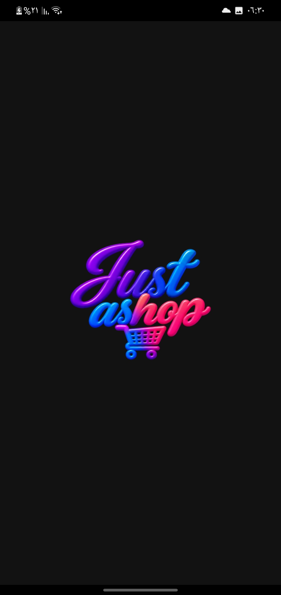 | 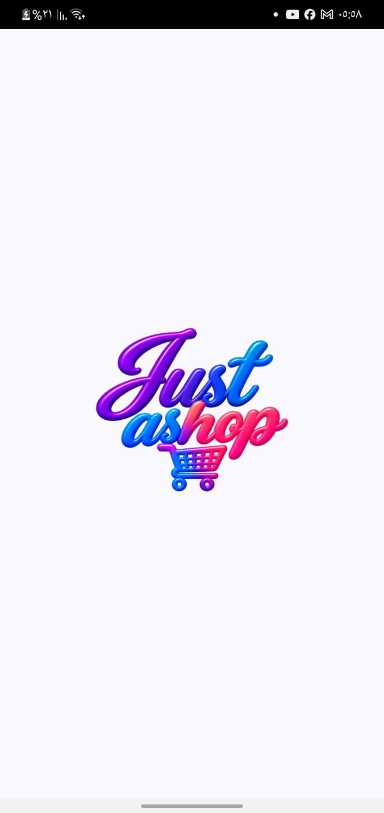 |
| Preferences | 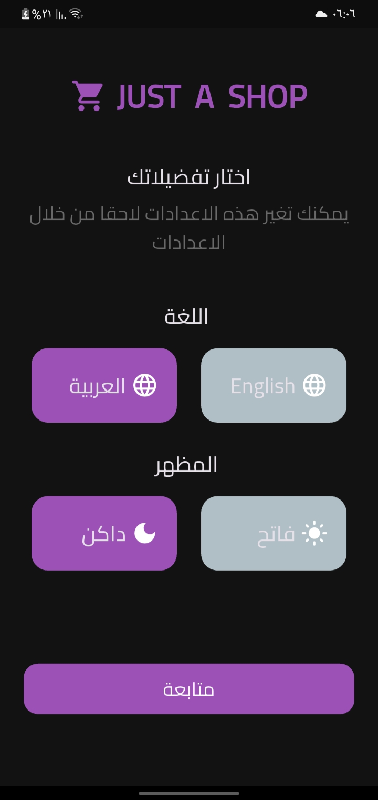 | 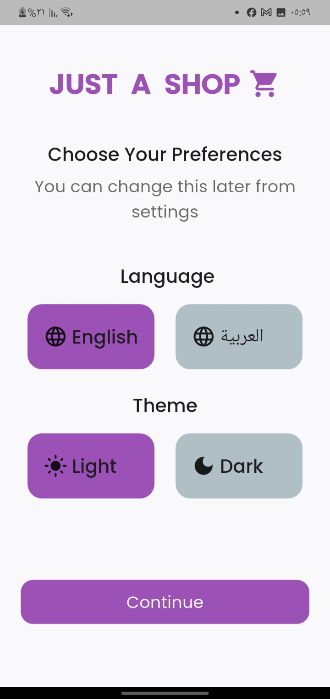 |
| Onboarding |  | 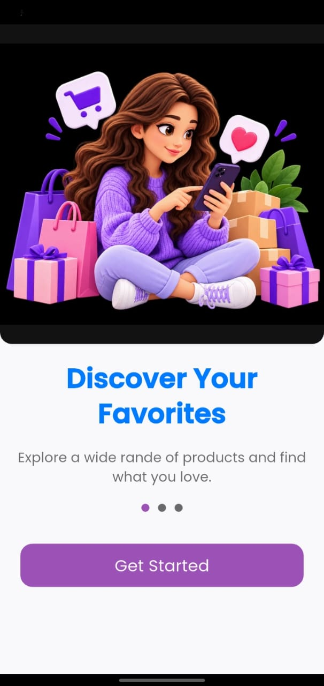 |
| Login |  | 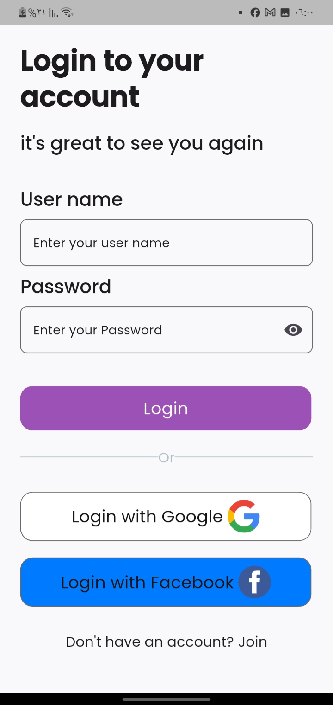 |
| Home | 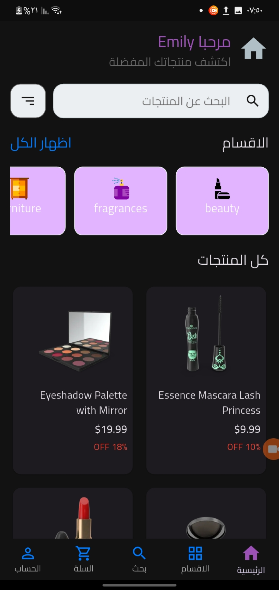 | 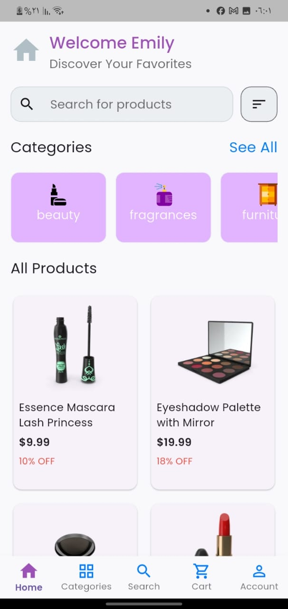 |
| Categories | 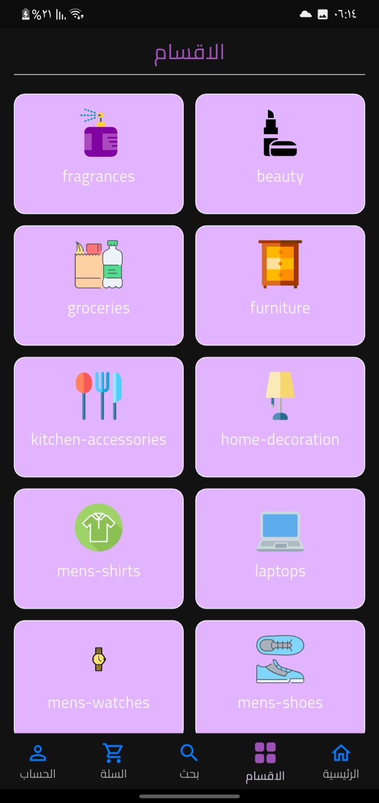 | 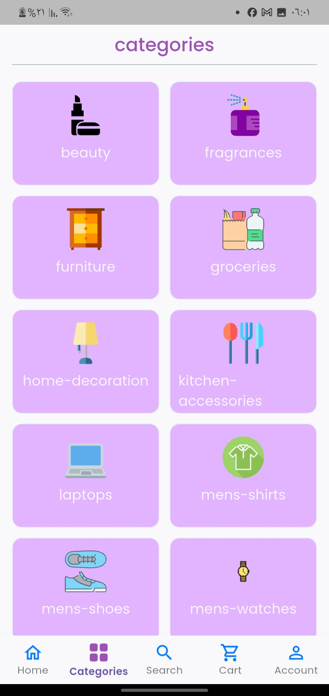 |
| Search | 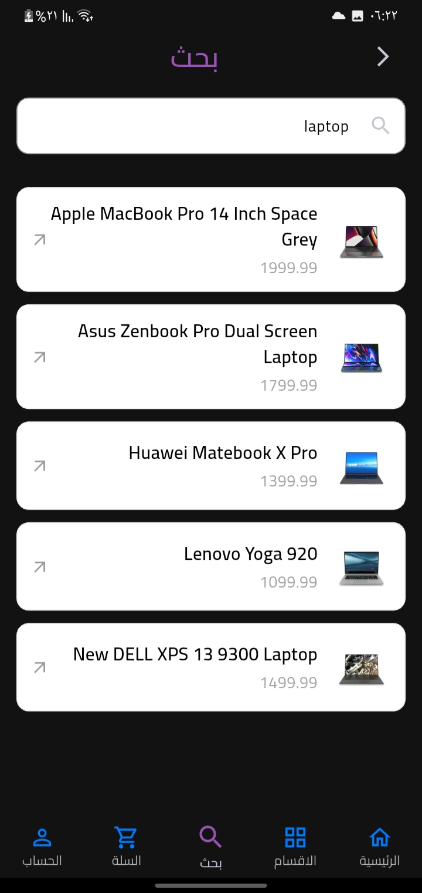 | 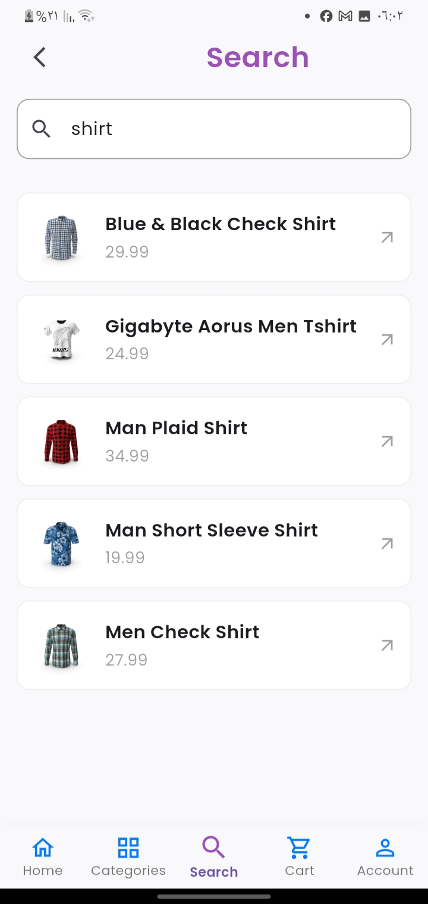 |
| Product Details | 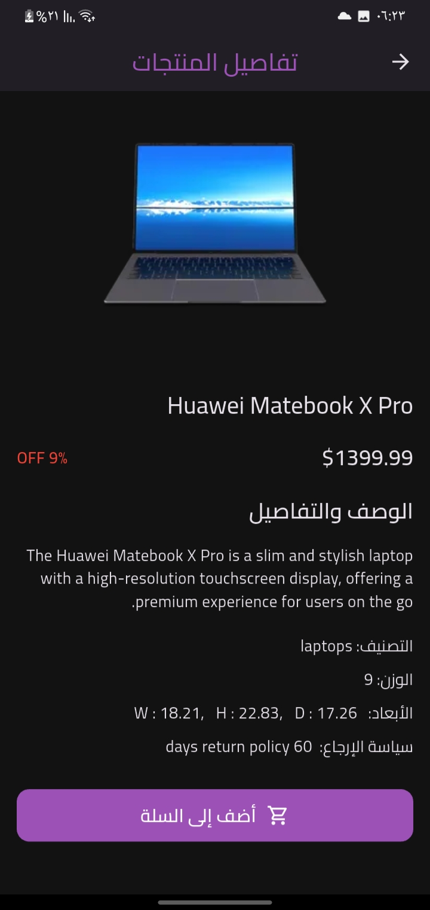 | 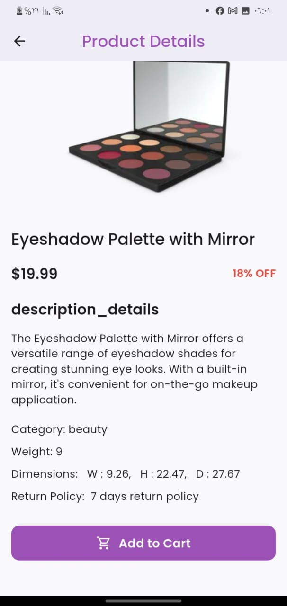 |
| Cart | 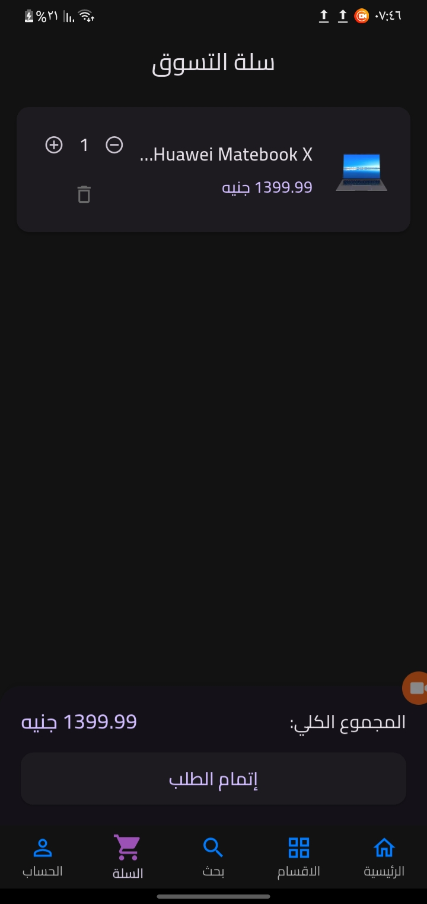 | 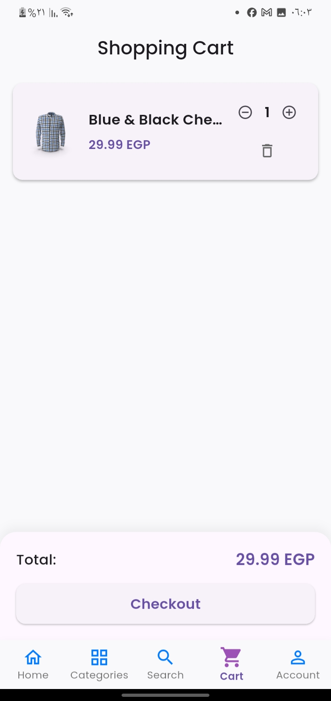 |
| Profile | 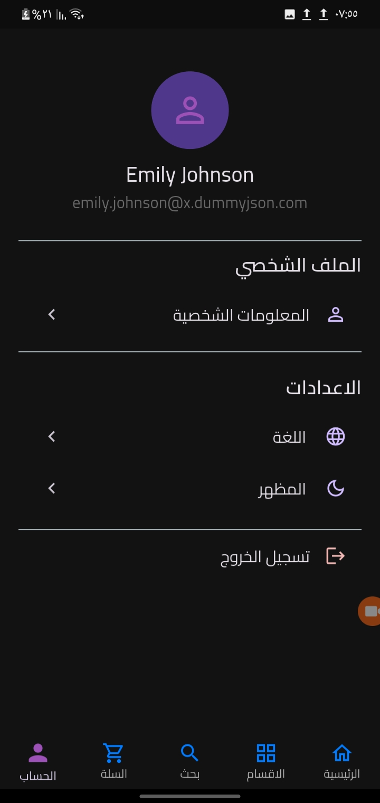 | 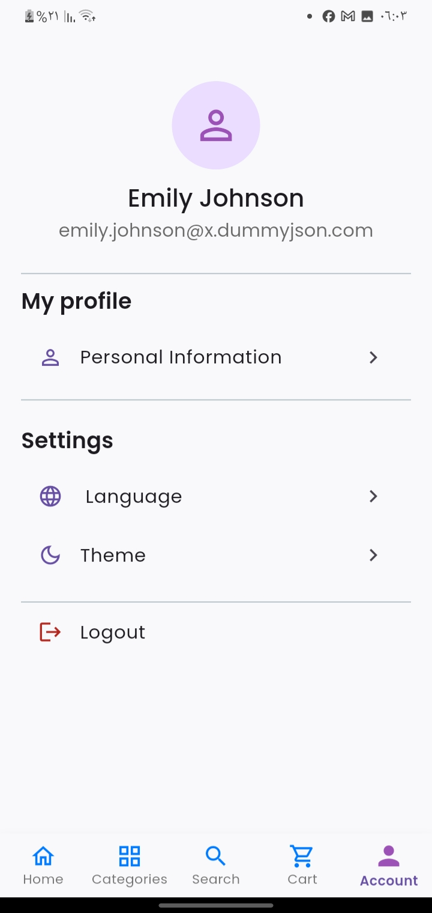 |
| Payment | 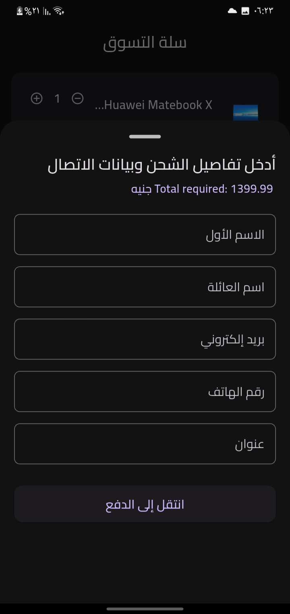 | 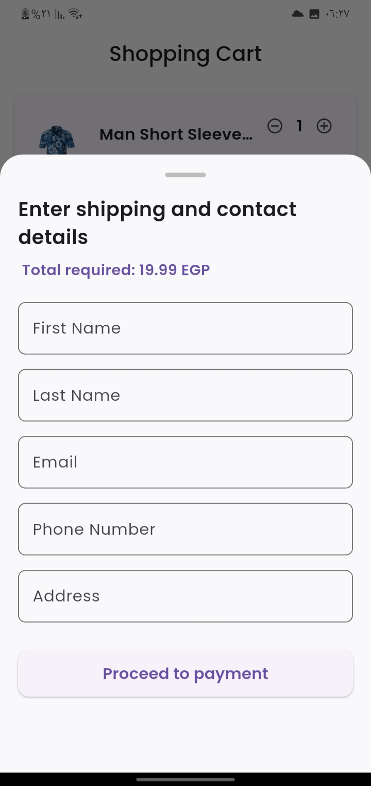 |


## 🧩 Challenges & Solutions

During development, several technical challenges were encountered and resolved, including:

- Resolving Android embedding and build configuration issues.
- Troubleshooting Firebase Authentication issues related to Facebook account linking and credential conflicts.
- Handling weak network connections by implementing loading states, error handling, and retry functionality for failed requests.
- Fixing UI layout issues and `RenderFlex` overflow errors.
- Resolving a Home search bar runtime issue related to missing Material widgets.
- Fixing the splash screen logo display issue.
- Resolving Android build compatibility issues related to the payment WebView library.


## 🤝 Teamwork & Version Control

The project was developed collaboratively using Git and GitHub, with feature branches, code reviews, and pull requests to manage changes and integrate team contributions.

## 👩‍💻 Team Members

- Rahma Ebrahem 
- Mariam Mohemed
- Heba Rostom

## 🔗 GitHub Repository

[Just a Shop Repository](https://github.com/rahmaEbrahem/just_a_shop)

---

*Just a Shop is an evolving e-commerce project built to practice and apply Flutter development, API integration, authentication, state management, localization, and collaborative software development.*
